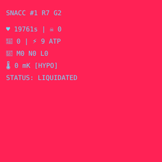
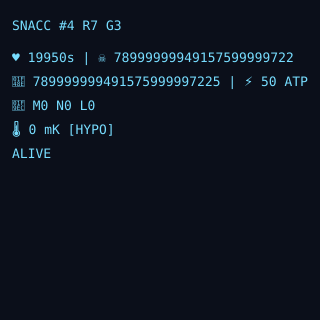

# DEMO-106 — Demo Evidence Pack (written "screenshots", no FE required)

**Status:** evidence captured **live on 2026-11-09** from this machine against the current
`snacc-v001.testnet` deployment (redeployed 2026-11-08; gladi: 51 tx, 22 KPI PASS);
every block below is real terminal/API output pasted verbatim (only truncation marks added where noted).
This pack substitutes for UI screenshots that need the frontend (`DEMO-101..104` video still pending owner acc).
**Item:** DEMO-106 · refreshed 2026-11-09 (earlier capture 2026-11-08 is quoted below where marked).
**Honesty:** `$SNACC` testnet has no monetary value; values are a point-in-time snapshot.

How each block was produced is shown above it, so a reviewer can re-run the same command.

---

## E1 · Step 1 — the contract account is alive on chain

```bash
curl -s -X POST https://near-testnet.drpc.org -H 'content-type: application/json' \
  -d '{"jsonrpc":"2.0","id":"v","method":"query","params":{"request_type":"view_account","finality":"final","account_id":"snacc-v001.testnet"}}'
```

```json
{"amount":"9635625232990506100000000","block_hash":"6TaEnHF6wmmGf7ARc3CCBEE8k5ERA6LLpwegoG6Bbwqe","block_height":276879122,"code_hash":"3DCPVk658pGuRW1FrDZKwrXQr3UHfYG43MoQUfbCwJwt","locked":"0","storage_paid_at":0,"storage_usage":450706}
```

Explorer link (`testnet.nearblocks.io/account/snacc-v001.testnet`) renders in a browser; from our
network `curl` gets **HTTP 403** (bot wall) — recorded honestly, the RPC output above is the
machine-checkable substitute. (Earlier capture, 2026-11-08, block 276760040.)

## E2 · Step 2 — full offline replay of the demo (zero keys)

```bash
npm run demo:replay
```

```
REPLAY OK — 51 tx · 14 beats · 0.01 s · keyless
  🥚 Birth (1 tx)
  🍽️ Feed → ATP → Allocate (2 tx)
  🧬 TEE zero-trust (3 tx)
  ⚙️ NEP-245 production chain (13 tx)
  🏪 NPC market-maker (1 tx)
  🔥 Shrinking supply (1 tx)
  🧫 Fusion & reproduction (4 tx)
  💰 Industrial dividend (2 tx)
  ⚔️ M&A & lysis (3 tx)
  💸 `$SNACC` transfer (1 tx)
  🏦 Vault sub-account (1 tx)
  🫀 NFT transplant (1 tx)
  📊 Consistency & solvency (3 tx)
  📜 NEP compliance (1 tx)
```

(`EXIT=0`. Note: **14 beats** — the older 12-beat capture predates the current manifest.)

## E3 · Step 3 — falsifiers, no keys, <5 s

```bash
npm run verify:thesis
```

```
PASSED F-01 — rpc=https://free.rpc.fastnear.com · storage_amount_per_byte=10000000000000000000 · 1734 B = 0.01734 NEAR (claim 0.01734) · savings 84.42% (claim 84.42%) · block=?
PASSED F-02 — ft_total_supply=2214131454347447129078242 == macro.supply=2.214131454347447e+24 (true) · burned=3.586854565255287e+22 > 0 (true) · before gladi=0
PASSED F-03 — signed_text matches (true) · ed25519 re-verification (true) · chat_id=14a1b709e99641f7afcaf0dfbe2dd0bd · pubkey=5a0210f2442c7935…
OCB-01 CONTEXT — OpenChainBench near-rpc status=live · leader=FastNEAR p50=33.0955ms successRate=100% · source=https://openchainbench.com/api/stat/near-rpc · does not affect the falsifiers

3/3 falsifiers NOT proven (thesis stands) · 1.7 s · keyless
```

(`EXIT=0`.)

## E4 · Step 4 — one zero-trust TEE transaction, raw logs from the chain

```bash
curl -s -X POST https://near-testnet.drpc.org -H 'content-type: application/json' \
  -d '{"jsonrpc":"2.0","id":"t","method":"EXPERIMENTAL_tx_status","params":["6s7UFfjd8XBPZ6b9FK4tzGhEo6kstAVeNMCpdwAT9FCN","snacc-v001.testnet"]}'
```

```
status: {"SuccessValue": "eyJzdHJhaW5faWQiOjUsIm93bmVyX2lkIjoic25hY2MtdjAwMS50ZXN0bmV0IiwidmF1bHRfc3ViYWNjb3VudCI6InMtNS0yNzY4MDEyODAuc25hY2MtdjAwMS50ZXN…"}
log: EVENT_JSON:{"standard":"snacc","version":"1.0.0","event":"genome_mutated","data":[{"kind":"genome_mutated","strain_id":5,"efficiency_shift_bps":450,"vitality_bonus":200}]}
```

What this tx proves: the genome mutation (`efficiency_shift_bps: 450`, `vitality_bonus: 200`) landed with
`SuccessValue` for strain 5. Offline re-verification of the TEE signature is E3/F-03.

## E5 · Step 5 — NEP-245 production chain in one transaction

Same command, hash `AWdh3Wuhkr7E5PRyi1rw7Bg7FFyYcydt2CAPx39Yzd57`:

```
status: {"SuccessValue": "eyJzdHJhaW5faWQiOjUsIm93bmVyX2lkIjoic25hY2MtdjAwMS50ZXN0bmV0IiwidmF1bHRfc3ViYWNjb3VudCI6InMtNS0yNzY4MD…"}
log: EVENT_JSON:{"standard":"snacc","version":"1.0.0","event":"dividend_inflow","data":[{"kind":"dividend_inflow","action":"catalyst_fee","fee":10000000000000,"burned":0,"inflow":5000000000000,"epoch":0}]}
log: EVENT_JSON:{"standard":"snacc","version":"1.0.0","event":"atp_spent","data":[{"kind":"atp_spent","strain_id":5,"purpose":"synthesize","cost":3}]}
log: EVENT_JSON:{"standard":"snacc","version":"1.0.0","event":"synthesized","data":[{"kind":"synthesized","strain_id":5,"token_out":"mt:elixir-aether","minted":1,"enzymes_burned":3,"catalyst_fee":10000000000000}]}
```

Enzymes → elixir with ATP cost and catalyst fee, all in-contract.

## E6 · Step 6 — keyless sub-account + NEP-171 transfer

Hash `G2zaGz4E3gLqyofxZNqXENu4WrcYxUrqVeW8dCgpwJEN` (vault):

```
status: {"SuccessValue": ""}
log: subaccount_materialized strain_id=5 sub_account_id=s-5-276801280.snacc-v001.testnet
```

Hash `88fJz3kdyzr1ZuHHxeNEVBEVNLNRBiFTRunVHnaQdsR5` (transfer):

```
status: {"SuccessValue": ""}
log: EVENT_JSON:{"standard":"nep171","version":"1.0.0","event":"nft_transfer","data":[{"old_owner_id":"snacc-v001.testnet","new_owner_id":"x207-demo-buyer.testnet","token_ids":["4"],"approved_account_ids":null,"memo":"gladi-t…"}
```

## E7 · Step 7 — read-only cloud API

```bash
curl -s https://8787-agq3sgcdseushmj4q73lv3xqea.instabox.tech/api/crucible/macro
```

```json
{"crucibleTemp":1040,"zone":"Fever","totalSnaccSupply":"2214131454347447129078242","totalSnaccBurned":"35868545652552870921758","ruleBoundTreasury":"471384202418197499999930","epochVolume":"2303271037165590050873014","history":[],"contractId":"snacc-v001.testnet","blockHeight":276879110}
```

(`EXIT=0`. The earlier 2026-11-08 capture showed `crucibleTemp: 0, zone: Hypothermia` at block
276759970 — the temperature moves with chain activity; the tx logs are the durable proof.)

## E8 · Step 8 — claims and their limits, verbatim from `README.md`

```
## Live evidence (testnet snacc-v001.testnet)

Point-in-time transactions from the committed gladi run — full hashes copied from evidence/gladi-manifest.json / docs/evidence-pack.md, auto-checked in evidence/gladi-kpi.md (22 KPI rows).
```

Headline status (auto-checked, hash-pinned): **22 PASS · 0 FAIL · 0 NOT YET** (`evidence/gladi-kpi.md`).

The `CLAIM LIMIT` block lives in `evidence/gladi-kpi.md` (what is **not** covered:
mechanics that are not implemented yet — KPI PASS only covers the implemented mechanics).

---

## E9 · Real SVG art pulled from the chain (visual evidence)

Extraction (per strain): `nft_token` → `metadata.media` = `data:image/svg+xml;base64,…` → decode →
write to `docs/assets/strain-<id>.svg`. Files below are the 2026-11-08 first capture
(byte-identical to what the contract served then); live sizes since changed with on-chain state
(see `docs/evidence-pack.md` N1: tokens 1, 4, 5 = 448, 476, 480 B at its check time):

| Asset | Bytes | Owner on chain (at capture) |
|---|---|---|
| [`assets/strain-1.svg`](assets/strain-1.svg) | 438 | `snacc-v001.testnet` |
| [`assets/strain-2.svg`](assets/strain-2.svg) | 439 | `snacc-v001.testnet` |
| [`assets/strain-4.svg`](assets/strain-4.svg) | 471 | `x207-demo-buyer.testnet` (transplanted!) |
| [`assets/strain-5.svg`](assets/strain-5.svg) | 473 | `snacc-v001.testnet` |




Example content (`strain-4.svg`, verbatim):

```svg
<svg xmlns="http://www.w3.org/2000/svg" width="320" height="320"><rect width="320" height="320" fill="#0b0f1a"/><g font-family="monospace" font-size="13" fill="#7df"><text x="12" y="30">SNACC #4 R7 G3</text><text x="12" y="62">♥ 19950s | ☠ 78999999949157599999722</text><text x="12" y="86">💎 789999999491575999997225 | ⚡ 50 ATP</text><text x="12" y="110">🧬 M0 N0 L0</text><text x="12" y="134">🌡 0 mK [HYPO]</text><text x="12" y="158">ALIVE</text></g></svg>
```

Vitality, treasury balance, ATP, organelle slots, macro temperature/zone — rendered from live state.

## What this pack does NOT prove

- No UI/frontend behavior (no FE exists yet — `DEMO-101..104` pending owner acc).
- No mainnet behavior; explorer pages verified only via RPC (nearblocks blocks curl with 403).
- Snapshots are point-in-time (2026-11-09, block heights ≈ 276.88M); re-run commands to refresh.
